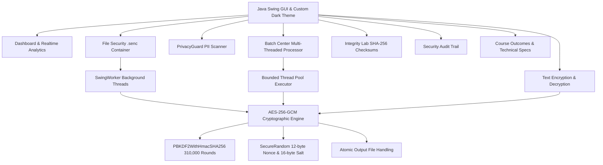

# CIPHERSHIELD — Secure Encryption & Decryption Desktop Tool

> **Academic Micro Project 03**  
> **Course Outcomes:** CO3 (Multithreading & Exceptions), CO4 (File I/O & String Manipulation), CO5 (GUI & Event-Driven Programming)  
> **Industry Focus:** Cyber Security and Software Tools  
> **Technology Stack:** Java 8+, Java Swing & AWT, AES-256-GCM, PBKDF2WithHmacSHA256, SHA-256, SecureRandom, SwingWorker

---

## 1. Project Overview

**CipherShield** is a native Java desktop cybersecurity suite engineered to provide authenticated encryption, local sensitive-data scanning, multi-threaded batch operations, and file integrity verification. Designed without external dependencies, it operates on standard Java SE 8+ runtimes.



---

## 2. Integrated Course Outcomes (CO)

### CO3: Develop Multithreading & Exception Handling Techniques to Enhance Performance
* **Responsive Background Execution:** Intensive file cryptographic tasks and digest calculations are decoupled from the Event Dispatch Thread (EDT) using `SwingWorker<Boolean, String>`.
* **Bounded Concurrency:** The `BatchProcessor` utilizes an `ExecutorService` fixed pool (bounded to 2 worker threads) to prevent I/O disk thrashing while keeping the interface responsive.
* **Granular Exception Hierarchy:** Domain-specific exceptions (`CipherShieldException`, `EncryptionException`, `DecryptionException`, `FileFormatException`, `ValidationException`) ensure error categories are safely reported without exposing raw stack traces.
* **Safe Error Recovery:** All file routines clean up temporary output files (`*.tmp.*`) upon failure or user cancellation, preventing orphaned corrupt data.

### CO4: Use File I/O & String Manipulation Techniques for Improved Data Handling
* **Custom Binary Container (`.senc`):** Enforces a versioned file layout including magic bytes (`CSHD`), container version, KDF round parameters, salt, nonce, and AES-GCM ciphertext with authenticated tags.
* **Atomic File Replacement:** Decrypted and encrypted outputs write to isolated temporary files first, finalizing via `Files.move(..., ATOMIC_MOVE)` only after successful tag validation.
* **PII Pattern Matching (PrivacyGuard):** Leverages `java.util.regex.Pattern` to detect sensitive credentials (emails, telephone numbers, campus student IDs) entirely in memory.
* **Streaming Cryptographic Hashing:** Computes SHA-256 fingerprints in 64 KB streaming buffers, preventing memory exhaustion on large files.

### CO5: Develop Interactive Applications Using GUIs & Event-Driven Programming
* **Modern Dark Theme:** Refined midnight-navy (`#0B101E`) surfaces with balanced cyan (`#22D3EE`) and violet (`#8B5CF6`) accents, consistent page headings, keyboard-accessible navigation, and unified audit-table styling.
* **Zero External Graphic Dependencies:** Procedural vector iconography (`IconFactory`) drawn dynamically via `Graphics2D` and `Path2D`.
* **Event-Driven Architecture:** Action listeners, document listeners, progress callbacks, and real-time dashboard statistic bindings.

---

## 3. Cryptographic Specification & `.senc` File Format

### Algorithm Parameters
| Parameter | Standard / Specification | Security Rationale |
| :--- | :--- | :--- |
| **Cipher & Mode** | `AES/GCM/NoPadding` (256-bit key) | Provides confidentiality and authenticated integrity |
| **Authentication Tag** | 128-bit GCM Auth Tag | Detects any unauthorized modification or tampering |
| **Key Derivation** | `PBKDF2WithHmacSHA256` | Password-based key stretching |
| **Iteration Count** | 310,000 iterations | Exceeds OWASP guidelines against brute-force attacks |
| **Salt** | 16 bytes (128 bits) | Generated via `SecureRandom` per encryption operation |
| **Nonce / IV** | 12 bytes (96 bits) | Unique per file; never reused |
| **File Checksum** | SHA-256 (FIPS 180-4) | Passive integrity auditing |

### Binary Header Structure of `.senc` Files
```
+---------------+---------------+--------------------+---------------+---------------+----------------+---------------+--------------------------+
| Magic (4B)    | Version (2B)  | Iterations (4B)    | Salt Len (1B) | Salt (16B)    | Nonce Len (1B) | Nonce (12B)   | Payload + Auth Tag (var) |
| 0x43 0x53 ... | 0x00 0x01     | Big-Endian integer | 0x10 (16)     | Random bytes  | 0x0C (12)      | Random bytes  | AES-GCM Ciphertext + Tag |
+---------------+---------------+--------------------+---------------+---------------+----------------+---------------+--------------------------+
```

---

## 4. Key Features

1. **Cybersecurity Dashboard:**
   * Live statistics (total sessions, authenticated successes, security rejections).
   * Real-time operational log populated strictly by actual application events.
   * Quick-launch tool cards and course outcome mapping.

2. **Text Encryption & Decryption:**
   * Password confirmation to prevent typographical lockout during encryption.
   * Safe Base64 transport encoding.
   * Password show/hide toggle.
   * Direct export to `.txt` and copy-to-clipboard actions.

3. **File Security Center (`.senc`):**
   * Arbitrary file encryption (documents, archives, binaries, images).
   * Existing files are preserved; new outputs receive a numbered filename when needed.
   * Live progress percentage and cancellation controls.
   * Atomic write protection.

4. **PrivacyGuard Scanner:**
   * Local regex scanner for pasted text and `.txt` / `.docx` files; drop files onto the scanner to load and scan them.
   * Detects emails, international phone formats, and Student IDs (`STU-XXXXXX`, `CS2024-XXXX`).
   * "Review & Encrypt" bridge connecting scanner findings directly to the cryptographic engine.
   * Standard Java ZIP/XML APIs extract DOCX content; no external dependency is required.
   * Zero external data transmission or disk persistence of detected values.

5. **Batch Center:**
   * Multi-file processing queue with per-file status monitoring (`Pending`, `Processing`, `Success`, `Failed`, `Cancelled`).
   * Drag-and-drop file queue, fault-isolated processing, and clear per-file failure reasons.
   * Existing destinations and duplicate basenames are preserved using numbered output filenames; repeated runs do not overwrite prior results.

6. **Integrity Lab:**
   * SHA-256 cryptographic fingerprint calculator with chunked memory streaming.
   * Live comparison against expected digests with distinct `MATCH` / `MISMATCH` badges.
   * Security advisory detailing the difference between unkeyed hashing and authenticated encryption.

7. **Security History:**
   * Local audit log stored at `~/.ciphershield/history.dat`.
   * Never stores plaintexts, passwords, derived keys, or sensitive findings.
   * Secure log clearing with confirmation.

---

## 5. System Requirements & Prerequisites

* **Operating System:** Windows 7 / 8 / 10 / 11, macOS, or Linux.
* **Java Runtime:** Java SE Development Kit (JDK) 8 or later (Tested on Eclipse Temurin OpenJDK 1.8.0_504).
* **Dependencies:** None (Uses pure standard Java SE libraries: `javax.crypto`, `java.awt`, `javax.swing`, `java.nio`).

---

## 6. Build and Run Instructions

### Windows (Batch Scripts)
```cmd
:: 1. Compile the complete project
build.bat

:: 2. Execute automated test suite (21 tests)
test.bat

:: 3. Launch the desktop application
run.bat
```

### Manual Commands (Cross-Platform)
```bash
# Compile to out directory
mkdir out
javac -d out -encoding UTF-8 -source 1.8 -target 1.8 $(find src -name "*.java")

# Run automated tests
java -cp out com.ciphershield.test.TestRunner

# Launch application
java -cp out com.ciphershield.CipherShieldApp
```

---

## 7. Automated Test Results

Executed via `test.bat`:

| Test ID | Test Scenario | Verified Behavior | Status |
| :---: | :--- | :--- | :---: |
| **01** | Text Encryption/Decryption Round Trip | 100% fidelity string recovery | **PASS** |
| **02** | File Encryption/Decryption Round Trip | 16 KB binary payload round-trip | **PASS** |
| **03** | Wrong-Password Rejection | Intercepted safely via `AEADBadTagException` | **PASS** |
| **04** | Modified Ciphertext Rejection | Bit-flip in ciphertext payload rejected | **PASS** |
| **05** | Modified Auth-Tag Rejection | Modified 128-bit tag caught by GCM verifier | **PASS** |
| **06** | Corrupted / Truncated File Rejection | Truncated file header intercepted | **PASS** |
| **07** | Missing-File Handling | Handled cleanly via `ValidationException` | **PASS** |
| **08** | Invalid File-Header Handling | Non-`CSHD` magic header rejected | **PASS** |
| **09** | Empty-Input Validation | Empty plaintexts and passwords rejected | **PASS** |
| **10** | Duplicate-Output Protection | Prevents accidental destination overwrite | **PASS** |
| **11** | SHA-256 Match and Mismatch | Exact digest matched; altered hash rejected | **PASS** |
| **12** | PrivacyGuard Pattern Detection | Detected email, phone, and student ID | **PASS** |
| **13** | Batch Failure Isolation | 2 files succeeded; 1 bad file failed safely | **PASS** |
| **14** | Cancellation Behavior | Operation aborted cleanly; temp files removed | **PASS** |
| **15** | Crypto Benchmark | PBKDF2 100k rounds completed within the 3-second test threshold | **PASS** |
| **16** | PrivacyGuard TXT File Scanning | Loaded and scanned email, phone, and student ID | **PASS** |
| **17** | PrivacyGuard DOCX File Scanning | Extracted DOCX XML and scanned sensitive patterns | **PASS** |
| **18** | Empty / Unsupported / Malformed Scanner Files | Rejected with clear validation errors | **PASS** |
| **19** | Batch `.senc` Decryption | Decrypted valid CipherShield container and verified bytes | **PASS** |
| **20** | Batch Wrong Password / Corrupt Container | Rejected both without creating plaintext output | **PASS** |
| **21** | Batch Duplicate Names / Repeated Runs | Created unique outputs without replacing existing files | **PASS** |

**Summary: 21 / 21 Passed (100.0% Pass Rate)**

---

## 8. Five-Minute Presentation Demonstration Sequence

When demonstrating this project for academic review or examination, follow this 5-minute workflow:

1. **Minute 1: Dashboard & Architecture Overview**
   * Launch `run.bat`.
   * Point out the dark cybersecurity theme, responsive layout, and the Course Outcomes badge (CO3, CO4, CO5).
   * Show that the dashboard metrics start with real data loaded from the local audit service.

2. **Minute 2: Text Encryption & Tamper Proofing (CO4 & CO5)**
   * Navigate to **Text Crypto**.
   * Enter sample text: `Confidential College Grade Report 2026`.
   * Demonstrate password confirmation validation (type non-matching passwords to show immediate error handling).
   * Type matching passwords and click **Encrypt Text (AES-GCM)**. Show the Base64 ciphertext output.
   * Modify one character in the ciphertext, click **Decrypt Ciphertext**, and show the authenticated rejection dialog (`AEADBadTagException`).

3. **Minute 3: PrivacyGuard PII Scanner (CO4)**
   * Navigate to **PrivacyGuard**.
   * Paste sample text containing an email (`student@university.edu`), phone number (`555-123-4567`), and Student ID (`STU-887766`).
   * Click **Scan Text** to demonstrate regex pattern extraction into the table.
   * Explain the local-only scanning model (zero external transmission).
   * Click **Review & Encrypt This Text ->** to show seamless workflow integration into the crypto tab.

4. **Minute 4: Secure File Container (.senc) & Cancellation (CO3 & CO4)**
   * Navigate to **File Security (.senc)**.
   * Choose any document or binary file.
   * Enter a password and click **Encrypt File -> .senc**.
   * Highlight the `SwingWorker` progress bar indicating PBKDF2 key derivation and atomic file writing.
   * Demonstrate decryption back to the original file and verify file contents.

5. **Minute 5: Integrity Lab & Security History (CO3 & CO5)**
   * Navigate to **Integrity Lab**. Select the decrypted file, click **Calculate SHA-256 Fingerprint**, and paste the generated digest into the expected box to display the green `✔ MATCH` badge.
   * Navigate to **Security History** to show all actions audited in real-time with zero sensitive data stored.
   * Navigate to **About & Specs** to conclude with the Course Outcomes mapping.
